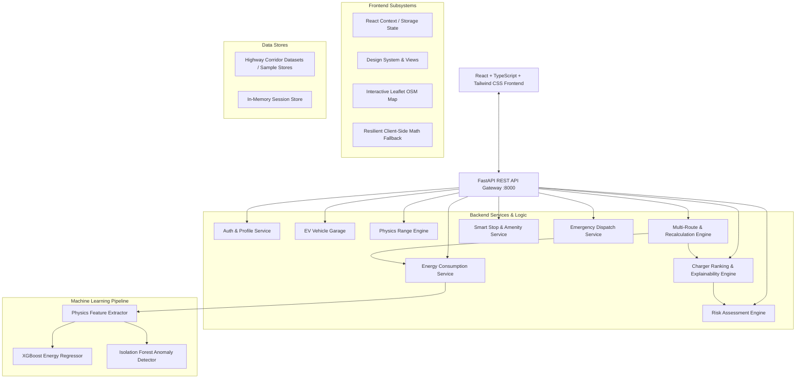

# ZepGO – Architecture & System Design Document

## 1. System Vision & Architecture Philosophy

**ZepGO** is built on a fundamental paradigm shift in EV navigation:
> *"ZepGO doesn't just tell an EV where to go. It predicts whether the EV can safely get there and intelligently decides where, when and why it should charge."*

Traditional navigation apps optimize for distance or static travel time, treating EV chargers as generic points of interest (POIs). ZepGO operates as an **Intelligent Energy & Navigation Operating System**, integrating:
1. Vehicle-specific battery physics and real-time state of charge (SOC).
2. Dynamic environmental factors (highway velocity, temperature, rain, elevation gain).
3. Supervised Machine Learning (XGBoost) for consumption regression.
4. Unsupervised ML (Isolation Forest) for anomalous energy draw detection.
5. Multi-factor Charging Intelligence ranking chargers by safety buffer, plug availability, connector compatibility, cost, and speed.
6. Transparent Explainability ("Why This Charger?") adhering to the WHAT, WHY, and IMPACT decision framework.

---

## 2. High-Level System Architecture

---

## 3. Component Breakdown

### 3.1 Frontend Architecture (`frontend/src/`)
- **Framework**: React 18, TypeScript, Tailwind CSS, Vite.
- **Map Subsystem**: Leaflet and React-Leaflet with custom SVG charging markers, route polylines, and viewport bounds fitting.
- **State Management**: Reactive state hooks (`useNavigationState`, React context) with persistent fallback storage in `localStorage`.
- **Offline / Low Network Resilience**: If the FastAPI backend is temporarily unreachable, the frontend automatically falls back to an identical client-side physics and mock intelligence engine, ensuring 0% blank screens or crashes.

### 3.2 Backend Architecture (`backend/app/`)
- **Framework**: Python 3.11 with FastAPI and Uvicorn.
- **Routing**: Clean RESTful routers modularized across 8 resource files (`auth.py`, `vehicles.py`, `prediction.py`, `charging.py`, `risk.py`, `trip.py`, `facilities.py`, `sos.py`).
- **Pydantic Validation**: Strict typing on vehicle parameters, battery SOC (0–100%), distances, and weather inputs.
- **Exception Handling**: Standardized HTTP exceptions and custom error wrappers for invalid coordinates, unknown vehicle IDs, and unreachable destinations.

### 3.3 Machine Learning Pipeline (`backend/app/ml/`)
- **Trained Model**: XGBoost Regressor (`xgb_energy_model.json`) trained on 15,000 synthetic Indian highway EV drive cycles.
  - **Metrics**: $R^2 = 0.9910$, $\text{MAE} = 1.33\text{ kWh}$.
- **Features Used (9 Inputs)**:
  1. `battery_capacity_kwh`
  2. `battery_soc_percent`
  3. `distance_km`
  4. `vehicle_efficiency_km_per_kwh`
  5. `average_speed_kmh`
  6. `traffic_factor`
  7. `temperature_celsius`
  8. `rain_factor`
  9. `elevation_gain_m`
- **Anomaly Detection**: Scikit-learn `IsolationForest` (`isolation_forest.joblib`) calibrated to normal highway efficiency distributions (4.5–7.5 km/kWh). Flags consumption anomalies (e.g. $< 3.5\text{ km/kWh}$ caused by low tyre pressure, aggressive acceleration, or headwinds).

---

## 4. Multi-Factor Charger Ranking & Explainability

Chargers are not ranked solely by geographical proximity. A charger 2 km away with 10 kW AC and a 45-minute queue is inferior to a 120 kW DC charger 12 km ahead with 3 open stalls.

The ranking score $S$ is computed as:
$$S = w_{\text{safety}} \cdot S_{\text{safety}} + w_{\text{avail}} \cdot S_{\text{avail}} + w_{\text{compat}} \cdot S_{\text{compat}} + w_{\text{cost}} \cdot S_{\text{cost}} + w_{\text{dist}} \cdot S_{\text{dist}} + w_{\text{speed}} \cdot S_{\text{speed}}$$

Where:
- $S_{\text{safety}}$: Penalizes arrival SOC below the user's safety reserve (default 18%).
- $S_{\text{avail}}$: Proportional to active unoccupied charging guns.
- $S_{\text{compat}}$: 1.0 for matching CCS2 / Type 2 plugs, 0.0 for incompatible standards.
- $S_{\text{cost}}$: Normalized inverse cost per kWh.
- $S_{\text{dist}}$: Normalized corridor deviation distance.
- $S_{\text{speed}}$: Weight favoring high-power DC fast chargers ($\ge 60\text{ kW}$).

Every recommendation produces an explainability contract:
- **WHAT**: The specific charging hub and recommended plug.
- **WHY**: The multi-factor rationale (e.g., "12 km from route, compatible CCS2, 24% arrival SOC, 3 plugs open").
- **IMPACT**: Time added (+24 min), cost added (+₹180), and resulting safety margin (+18% buffer).

---

## 5. Security & Deployment

- **Containerization**: Dual Dockerfiles (multi-stage Node/Nginx for frontend, Python 3.11-slim for backend) orchestrated via `docker-compose.yml`.
- **Environment Isolation**: `.env.example` isolates all third-party API keys and server endpoints.
- **CORS Middleware**: Explicitly whitelists development (`localhost:5173`, `127.0.0.1:5173`) and production hosts.
