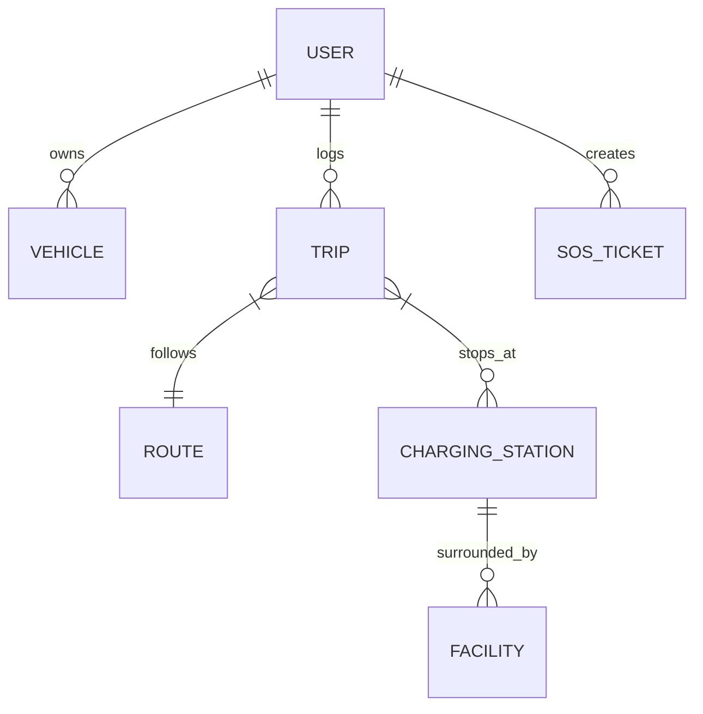

# ZepGO – Data Models & Database Schema

The ZepGO platform utilizes a modular data layer. For local rapid prototyping and testing, high-speed verified JSON data stores are backed by Pydantic models. For production cloud deployments, these models map 1-to-1 to Firestore / PostgreSQL / MongoDB.

---

## 1. Entity Relationship Diagram



---

## 2. Model Schemas

### 2.1 User (`backend/app/models/user.py`)
```json
{
  "id": "usr-preethi-01",
  "name": "Preethi",
  "email": "preethi@zepgo.io",
  "phone": "+91 98765 43210",
  "active_vehicle_id": "veh-nexon-ev-max",
  "safety_reserve_percent": 18.0,
  "route_preference": "energy_efficient",
  "charging_preference": "fast_charging",
  "low_network_mode": false,
  "created_at": "2026-01-15T09:00:00Z"
}
```

### 2.2 Vehicle (`backend/app/models/vehicle.py`)
```json
{
  "id": "veh-nexon-ev-max",
  "brand": "Tata",
  "model": "Nexon EV Max",
  "year": 2024,
  "battery_capacity_kwh": 40.5,
  "usable_capacity_kwh": 38.5,
  "efficiency_km_per_kwh": 6.8,
  "connector_type": "CCS2",
  "max_charging_speed_kw": 50.0,
  "ac_charging_speed_kw": 7.2,
  "tare_weight_kg": 1400.0,
  "drag_coefficient": 0.32
}
```

### 2.3 Charging Station (`backend/app/models/charging_station.py`)
```json
{
  "id": "cs-zeon-salem",
  "name": "Zeon Charging Hub - Salem Highway",
  "operator": "Zeon Charging",
  "latitude": 11.6643,
  "longitude": 78.1460,
  "address": "NH544 Salem Bypass, Opp. Saravana Bhavan, Salem, TN",
  "connector_type": "CCS2",
  "charging_speed": 120,
  "price_per_kwh": 18.5,
  "availability": "Available",
  "total_chargers": 4,
  "available_chargers": 3,
  "operating_status": "Online",
  "estimated_waiting_time_mins": 0,
  "distance_from_route_km": 0.2,
  "supported_vehicles": ["Tata Nexon EV", "MG ZS EV", "Mahindra XUV400", "Hyundai Ioniq 5"],
  "rating": 4.8
}
```

### 2.4 Facility (`backend/app/models/facility.py`)
```json
{
  "id": "fac-salem-ccd",
  "station_id": "cs-zeon-salem",
  "name": "Cafe Coffee Day - Highway Plaza",
  "category": "Cafe",
  "distance_m": 45,
  "rating": 4.6,
  "is_open": true,
  "opening_hours": "24 Hours",
  "amenities": ["Wi-Fi", "Air Conditioning", "Clean Restrooms", "Outdoor Seating"]
}
```

### 2.5 Trip History (`backend/app/models/trip.py`)
```json
{
  "id": "trip-chn-cbe-88",
  "user_id": "usr-preethi-01",
  "vehicle_id": "veh-nexon-ev-max",
  "origin": "Chennai",
  "destination": "Coimbatore",
  "distance_km": 510.0,
  "energy_consumed_kwh": 72.4,
  "charging_stops_count": 2,
  "charging_cost_inr": 850.0,
  "duration_mins": 435,
  "average_efficiency_km_per_kwh": 7.1,
  "co2_saved_kg": 98.4,
  "date": "2026-10-18"
}
```

### 2.6 Emergency SOS Ticket (`backend/app/models/trip.py`)
```json
{
  "id": "sos-2026-901",
  "user_id": "usr-preethi-01",
  "emergency_type": "Low Battery Emergency",
  "latitude": 11.45,
  "longitude": 77.82,
  "battery_soc_percent": 4.0,
  "dispatch_status": "Roadside Mobile Charger Dispatched",
  "eta_mins": 18,
  "nearest_service_center": "Tata Motors Service Hub, Erode",
  "assistance_contact": "+91 1800 209 8282"
}
```
